# GitDone

[](STATUS.md)
[CI](https://github.com/ArtJack/gitdone/actions/workflows/ci.yml) ·
[PyPI](https://pypi.org/project/gitdone/) ·
[MIT license](LICENSE)

**Your agent says it shipped. Git decides.**

One markdown table of what must exist for a project to be done, with every row held to git. A row is Live only when a commit on
the default branch or a merged pull request says so. A commit that would make the numbers lie is refused, and a claim stops holding
the day its commit is reverted.

<p align="center"></p>

No account, no server, no model calls, no dependencies. The files live in your repository and stay readable without the tool.

## Try it

```bash
pipx install gitdone
```

Then, in your repository:

```bash
gitdone init --from-checklist TODO.md --hook --ci   # or: --rows "Sign-in, Search, Export"
gitdone shipped 1 <commit>                          # refused unless that commit is on your default branch, pushed if you have a remote
git add .gitdone.json status-table.md STATUS.md .github && git commit -m "Track status"   # the gate runs here
```

`--ci` adds [the GitHub Action](docs/ci.md), which is the gate no flag can skip. The hook is a courtesy that lives in this clone, so another clone runs
`gitdone install-hook` once.

To try it with nothing installed, put [`uvx`](https://docs.astral.sh/uv/) in front of each command: `uvx gitdone init --rows "A, B"`.

Using a coding agent? In Claude Code: `/plugin marketplace add ArtJack/gitdone`, then `/plugin install gitdone@gitdone`.
Cursor, Codex and others: `npx skills add ArtJack/gitdone`. [The details](docs/agents.md).

## What it writes

| File | What it is | Who edits it |
|---|---|---|
| `status-table.md` | The table: one row per capability, one status each | You, or `shipped`, `mark`, `add`, `remove` |
| `STATUS.md` | The view: the numbers, what is left, what is live and why | Nobody: it is generated |
| `.gitdone.json` | The plan: the title, the repository, the kinds and their weights | You, rarely |

A row is one of four kinds. **Live:** a commit, pull request or tag on the default branch says so. **Built, not live:** on a branch that exists. **Partial:** a
note says what exists. **Not built.** *Strict* counts Live rows, which is what an outside reviewer would count. *Weighted* also credits the
others, at weights you can read and argue with in the plan.

`STATUS.md` after the session below:

<!-- view:start -->
> **kiosk: 4 rows**
>
> - **Strict:** 1 of 4 live · `█████░░░░░░░░░░░░░░░` 25%
> - **Weighted:** `█████░░░░░░░░░░░░░░░` 25%
> - Built, not live: 0 · partial: 0 · not built: 3
>
> | Domain | Rows | Live | Built | Partial | Not built | Strict | Weighted | |
> |---|---|---|---|---|---|---|---|---|
> | 1. Scope | 4 | 1 | 0 | 0 | 3 | 25% | 25% | `███░░░░░░░░░` |
>
> **What is left: 3 of 4 rows**
>
> | # | Name | Status | Note |
> |---|---|---|---|
> | 2 | Search | Not built |  |
> | 3 | Export | Not built |  |
> | 4 | Reports | Not built |  |
>
> **Live: 1 of 4 rows**
>
> | # | Name | Evidence |
> |---|---|---|
> | 1 | Sign-in | *(Live 2026-10-31: `660d81a`; was Not built)* |
>
> ---
>
> Tracked with [gitdone](https://github.com/ArtJack/gitdone): every Live row names its evidence, and git holds it to that.
<!-- view:end -->

## What happens

<!-- demo:start -->
```console
# Four things must exist for this to be done.
$ gitdone init --rows "Sign-in, Search, Export, Reports" --hook
wrote .gitdone.json, status-table.md (4 rows) and STATUS.md
All: strict 0% (0/4), weighted 0% · next: row 1 (Sign-in)

# The agent says sign-in shipped, and names a commit from its spike branch.
$ gitdone shipped 1 705af2a
refused, nothing changed: commit 705af2a is not on main
Still on a branch? Record it with: gitdone mark 1 built --branch NAME

# The commit that really landed:
$ gitdone shipped 1 660d81a
row 1: Not built → Live (verified: commit 660d81a is on main)
All: strict 25% (1/4), weighted 25% · next: row 2 (Search)
to commit: git add status-table.md STATUS.md

# Someone types Live into the table by hand, with nothing behind it.
$ git add -A && git commit -m 'Search is live'
FAIL row 2 names no commit, pull request or tag; run `gitdone shipped 2 <commit>`
result: FAIL in --strict, evidence is missing or partly disproved

# Later, sign-in is reverted on main. The claim stops holding.
$ gitdone check
FAIL row 1 (Live): commit 660d81a was reverted on main by 3321f15
  what is true now? gitdone mark 1 <kind> <words>, or shipped 1 <the new commit>
result: FAIL, 1 contradicted or inconsistent

# Your agent says it shipped. Git decides.
```
<!-- demo:end -->

Every line above is real output, with the longer commands trimmed: [`docs/demo/record.py`](docs/demo/record.py) runs it, and a test keeps this copy true.

A checklist's checked items are Live only if what they name holds. The rest start as Partial, with the reason beside them, so the first number
you see is already true. `--from-issues` does the same from GitHub issues.

## When will it be done, and where did the time go?

A percent does not say when, and it does not say why a month became three. These do, from the same two files.

<!-- timeline:start -->
```console
$ gitdone eta
Likely done Apr 14, 85% sure by Apr 29: a line through the last 28 days, not a promise.
Left: 8.7 of 16 rows (weighted 46%, strict 25%).
Pace: 0.21 rows a day; rows moved on 6 of 28 days.
Scope: 5 rows added, 0 taken out in that time.
Deadline Apr 15: likely 1 day early. It needs 0.2 rows a day from here; the pace is 0.21.
  Work █████████░░░░░░░░░░░ 46%
  Time ███████████░░░░░░░░░ 54%, Jan 12 to Apr 15

In the plan's order:
  S1 Reading lists and renewals  0.4 left, likely Mar 5
  S2 Returns                     1.5 left, likely Mar 13
  S3 Accounts                    1.6 left, likely Mar 20
  Everything else                5.2 left, likely Apr 14

$ gitdone add "Self-service printing"
added row 17
That moves the likely date from Apr 14 to Apr 19 (+5 days).

$ gitdone focus
Last 14 days: 13 commits.
  On plan    8   62%  rows 7 (2), 10 (2), 3 (1), 6 (1), 9 (1), 15 (1)
  Upkeep     2   15%
  Off plan   3   23%  printer (2), theme (1)

Off plan, newest first:
  1cb92cf Rewrite the receipt printer driver again (printer)
  336e685 Try a new theme engine for the kiosk (theme)
  35f4148 Rewrite the receipt printer driver (printer)

Next on the plan: S1 (Reading lists and renewals). It needs the head librarian's word at release.
Off plan is not wrong, only unplanned. If it belongs, `gitdone add "<what it is>"` puts it in the scope, and the date moves.
To tie a commit to a row, name the row in its message: row 12.
```
<!-- timeline:end -->


Adding a feature moves the date, and dropping one moves it back. Commits that serve no row are named while there is still time to ask why. None of this can stop a commit, and the date
says what it is. [How each is worked out, and what it cannot tell](docs/timeline.md). The history here is Bramble Kiosk's, a [fictional sample](examples/bramble/STATUS.md).

## What you get

- **Why.** A task tracker tells you what to do next. It cannot tell you how far along you are, because a closed task is only someone's word.
  This answers the other question, with a number that traces to commits, and it says what it could not verify.
- **A gate that reads what the commit will contain.** The local hook judges git's index, not your disk, and stays out of every commit that
  does not touch the tracker. Sixty claims in a repository of a thousand commits take about 0.2 seconds.
- **Claims that can stop holding.** Each run checks each row again. A reverted commit, through `git revert` or GitHub's button, turns its
  row into a failure until someone says what is true now, and the headline says so.
- **A date with its range, and what a feature costs.** `eta` draws a line through the table's own history and says it is a line. `add` and `remove` say what they did to it. With a
  deadline, it says how late, and burns time against work.
- **Focus.** `focus` sorts recent commits into on plan, upkeep and off plan, with the reason for each. `next` lists the rows to work on now. A hook says when a commit was off plan, and the
  opener says the numbers when an agent starts a session.
- **A traceability matrix nobody keeps by hand.** `matrix` ties each requirement in your spec to its row, evidence and tests, and names the two gaps: a requirement with no row, and a row nobody asked for.
- **A burn-up chart from your git history,** from the table's first commit on, with the scope line visible when it grows. It is the record, so it carries no forecast. `chart --burndown` is the one that does.

  

- **A badge,** kept with the view by `init --badge` or `badge --keep`, so it needs no CI: 
- **A comment on every pull request that moves a row,** with findings on the table's lines in the diff. [The Action](docs/ci.md) needs no key
  and no install.
- **`report`:** the evidence row by row, as Markdown, for a client or a manager who will never open the repository.
- **`portfolio`:** every tracked project under a folder, on one page.
- **Agents held to it.** A skill, an `AGENTS.md` section, a Claude Code plugin and a read-only MCP server: [coding agents](docs/agents.md).

The chart and the badge here belong to Bramble Kiosk, a [fictional sample](examples/bramble/STATUS.md).

## What installs, and when it runs

Measured from the code, and [`SECURITY.md`](SECURITY.md) has the rest.

| | |
|---|---|
| Dependencies | None: Python 3.9 or newer and its standard library |
| Processes it starts | `git`. `gh` or `glab`, only for a row that names a pull request or merge request, and never with `--offline` |
| Files it writes | The table, the view and the badge (`shipped`, `mark`, `add`, `remove`, `render --write`), what `init` creates, the workflow (`install-ci`), what you pass to `--out`. Reading commands write nothing |
| Git hooks | Only with `install-hook` or `init --hook`. In `.git/hooks`, never committed, and it refuses to replace a hook it did not write. `post-commit` only ever says a line, and `--no-focus` leaves it out |
| Network | None of its own |
| Telemetry, model calls | None |
| Claude Code plugin | One SessionStart hook that prints a line and can never stop a session, two skills, no agent |

## Commands

| Command | What it does |
|---|---|
| `gitdone` | Where the project stands, what is next, and whether the gate holds. Also `status`, `opener` |
| `init` | Start a tracker: `--rows`, `--from-checklist FILE`, `--from-issues [LABEL]`, `--hook`, `--ci`, `--agents`, `--badge` |
| `shipped <row> <evidence>` | Move a row to Live, or refuse. Evidence is a commit id, `PR #12`, `MR !12` or `tag v1.2`. `--allow-unverified` takes a claim nothing here could ever check, and the note says so |
| `mark <row> <kind> [note]` | Move a row short of Live, held to that kind's rule. `--branch NAME` |
| `add <name>`, `remove <row>` | Change the scope and keep the counts true. `--domain`, `--new-domain`, `--kind`, `--note` |
| `rows` | List rows. `--open`, `--kind`, `--domain` |
| `check` | The gate. Plain, it fails only on a proven contradiction. `--strict`, what the hook and the Action run, fails on anything not checked. `--offline`, `--if-staged`. [Rules and exit codes](docs/gate.md) |
| `next` | What to work on now: the next workstream's open rows |
| `eta` | When it will be done if the work goes on as it has, with a range, the scope's effect and the deadline. `--days`, `--group` |
| `focus` | Where the commits went: on plan, upkeep or off plan. `--days`, `--all` |
| `matrix` | A traceability matrix: requirement, row, evidence, tests. `--out`, `--offline` |
| `week [since]` | What moved since a date, a span or a commit, from the table's git history |
| `render`, `counts` | Print the view or the counts table. `render --write` writes the view; `counts --write` updates a counts table you pasted into the table |
| `chart` | The burn-up: `--out FILE` for an SVG, `--csv`, `--json`, `--group`. `--burndown` draws what is left, with `eta`'s line through it |
| `badge` | The numbers as a badge: `--svg FILE`, `--endpoint FILE`, `--keep`, `--label` |
| `report` | The evidence behind the numbers, row by row. `--out`, `--offline` |
| `portfolio [folder...]` | Every tracked project under a folder. `--out` |
| `doctor` | Everything the tracker needs here, on one screen. `--offline` |
| `where` | Which plan this folder resolves to |
| `install-hook`, `install-ci`, `install-agents`, `install-skill` | The local gate (`--lenient` only warns about missing evidence, `--no-focus` leaves out the post-commit line), the GitHub Action, the `AGENTS.md` section, a project-level skill |
| `ci`, `mcp` | What the Action runs, and read-only tools over stdio |

`--json` works on `gitdone`, `status`, `check`, `next`, `eta`, `focus`, `matrix`, `week`, `where`, `rows`, `report`, `doctor`, `chart` and `portfolio`: [the shapes](docs/json.md).

## The method, in one paragraph

The table is the one place a status changes, and only on a release or a reviewed branch, never because work started. The view is generated
from it, and nobody edits it by hand. Rows are capabilities a stranger could check, not tasks, so the table is also your definition of done,
reviewed like code. [The whole method](docs/method.md) is a page, and it works without the tool. For more depth:
[the status table](docs/status-table.md), [the plan file](docs/plan-file.md), [evidence and the gate](docs/gate.md), [time, focus and traceability](docs/timeline.md).

## How it compares

These tools are good at other jobs, and most pair well with this one.

| | The question it answers | "Done" means | Is the claim checked against git? |
|---|---|---|---|
| **gitdone** | How far along is this scope, provably? | A commit on the default branch or a merged PR says so | Yes: at commit time, in the PR, and again after a revert |
| Task trackers for agents (beads, Backlog.md, Taskmaster) | What should the agent do next? | Someone closed the task | No |
| Spec tools (spec-kit, OpenSpec) | What are we building? | The tasks under the spec got ticked | No |
| Issue boards (GitHub Projects, Linear) | Who is doing what? | The issue is closed | A linked PR can close it; nothing checks it stayed merged |
| Claim checkers (agent-claimcheck) | Did this agent do what it just said? | The session's trace supports it | At claim time, for one claim, with no view of the project |
| Delivery forecasts (Jira, LinearB, Jellyfish) | When will it ship? | The ticket closed | Against activity, not against what a row claims |
| Traceability tools (Jama, Polarion, DOORS) | Is every requirement covered? | Someone linked and approved it | No, and someone keeps it by hand |
| [Verdict](https://github.com/ArtJack/verdict) | Is what shipped any good? | A QA verdict with evidence | Yes, about quality. The sibling of this tool, and a plan can show its record |

## FAQ

**What gets past the gate?** The hook is a courtesy and CI is the gate: `--no-verify`, a rebase or a cherry-pick skip the hook, and the Action judges what arrived.
A real commit cited for the wrong row passes, and a reviewer sees that on one line of the diff. A pull request can edit the gate's own rules, and the Action says so out
loud. [The rules, and what the gate cannot tell](docs/gate.md#what-the-gate-cannot-tell).

**A commit was reverted and the number did not drop?** The number is what the table says, and only a person moves a row. The gate fails, and the headline
says so, until someone says what is true now. Then the number moves, in a commit with their name on it. The view and the badge change the same way.

**Can a row just be deleted?** Yes: scope is a person's decision, in a diff with their name on it. `week` and the Action's comment say which rows left, the chart's
top line moves, and `rows_total` in the plan makes it a deliberate edit.

**Two branches moved rows, and the table conflicts?** Resolve `status-table.md` as you would any file, then `gitdone render --write`. The gate names a conflict marker
it finds. The view is generated, so either side will do.

**Does it read my code?** No. A status is a person's claim, and the engine holds the claim to its evidence. It proves a commit is on the default
branch, not that the commit holds the feature. The claim and its commit sit on one line of the table's diff, where a reviewer sees them.

**Is the date a promise?** No, and the same sentence says so. `eta` is a line through the table's own history, with a range. It is there for one decision: cut the scope, or move the date. With too
little history it gives no date. The burn-up stays a record, and the view never shows a forecast. [What it cannot tell](docs/timeline.md#what-it-cannot-tell).

**Can `focus` stop a commit?** No. Off plan is not wrong, only unplanned. The hook says one line after the commit, and `--no-focus` leaves it out. The numbers exist so that someone can ask, while it still matters.

**We squash-merge.** Cite the squash commit, or the pull request. A branch's old tip is not on the default branch.

**A monorepo?** One tracker per package: the nearest `.gitdone.json` wins. `repo` can also point elsewhere, so a tracker may live apart from
the code it measures.

**GitLab?** `MR !12` is verified through `glab`. So far that path is tested against a stub of `glab`, not a real GitLab; a report from one is welcome.

**Windows?** The engine uses nothing platform-specific, and the hooks are `sh`, which Git for Windows runs. It is less proven there than on macOS and
Linux.

**No git at all?** It still renders and counts, and every claim stays unproven until there is a repository.

**Do I need the plugin?** No. The engine stands alone. Everything else is a thin layer over the same commands.

## This repository tracks itself

[`STATUS.md`](STATUS.md) is this project's own view, under its own gate, with this roadmap as its scope. The rows that are Live name the commits that
made them so.

## Contributing

[`CONTRIBUTING.md`](CONTRIBUTING.md). The reports that matter most: a claim the gate accepted and should not have, or refused and should not have.

## License

[MIT](LICENSE).

GitDone is an independent project, not affiliated with or endorsed by the Git Project. Git is a trademark of Software Freedom Conservancy.
